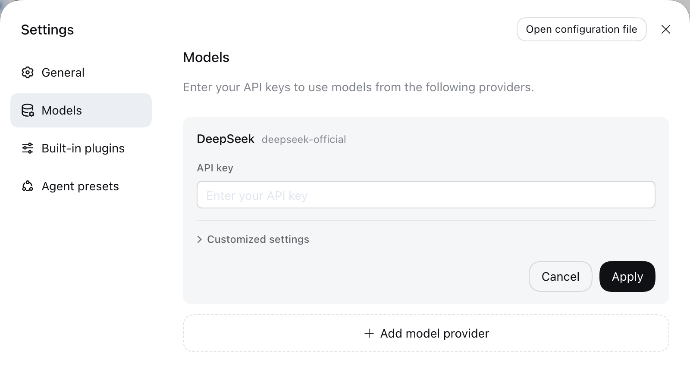

<a id="configure-models"></a>

# Configurer les modèles

<!-- USER_LANGUAGES_START -->
[English](providers.md) | [中文](providers.zh.md) | [Русский](providers.ru.md) | [日本語](providers.ja.md) | [Español](providers.es.md) | Français | [Deutsch](providers.de.md) | [Português](providers.pt.md) | [한국어](providers.ko.md)
<!-- USER_LANGUAGES_END -->

Ce guide suppose que vous avez lancé l’interface web en suivant le [guide de développement](../../development.md). Les changements de modèle prennent effet dès la requête suivante, sans redémarrer le serveur.

<a id="configure-deepseek"></a>

## Configurer DeepSeek

Ouvrez **Paramètres → Modèles**. La carte DeepSeek comporte un seul champ pour la clé API. Saisissez la clé et enregistrez-la.



Les clés sont accessibles uniquement en écriture. Après l’enregistrement, la page reçoit un descripteur expurgé. La valeur du secret ne lui est jamais transmise. La clé est stockée dans `$DSH_HOME/.credentials.yaml` et les paramètres n’en conservent que la référence.

Avec une clé sauvegardée et le paramètre par défaut, les modèles de DeepSeek suivent la liste publiée par l'API DeepSeek. La liste se charge lorsque les modèles sont nécessaires pour la première fois, se rafraîchit en arrière-plan environ toutes les dix minutes pendant qu'ils sont utilisés, et revient aux modèles intégrés quand il ne peut pas se charger. Édition **Modèles** sous **Paramètres personnalisés** conserve votre propre liste à la place et cesse de suivre celle publiée; **Restaurer les valeurs par défaut** La carte montre les modèles intégrés, de sorte qu'un modèle nouvellement publié n'apparaît que dans le sélecteur de modèle. [Référence du fournisseur API-key](../../../packages/llm/llm-deepseek-api-key/README.md) possède les règles d'inscription, de retrait et de gating.

<a id="add-a-third-party-provider"></a>

## Ajouter un fournisseur tiers

Choisir **Ajouter le fournisseur de modèle**. La carte s'ouvre sur **Fournisseur de modèles tiers**: choisissez un fournisseur avec dsh — la liste affiche les ids du fournisseur tels que `anthropic`, `openai`, `moonshotai` pour Kimi, ou `zai` pour GLM — entrez sa clé API et enregistrez. Le catalogue installé fournit la liste des paramètres, des protocoles et des modèles.

L'authentification **?** explique la priorité et les replis d'environnement enregistrés. Laissez la clé vide pour utiliser un titre de créance enregistré ou essayez les variables d'environnement énumérées. Un indice vert identifie une variable d'environnement détectée. Une pointe jaune signifie qu'aucune variable de reconnaissance n'a été détectée; entrez une clé API ou configurez la variable répertoriée. Un indice non confirmé signifie que l'état de lecture a échoué. La détection ne valide pas le justificatif ou ne teste pas la connexion. Les fichiers de justificatifs gérés par le fournisseur, y compris les profils AWS et les identifiants par défaut de l'application Google, sont en dehors de cette vérification. Les fournisseurs sans authentification de clé native, comme `openai-codex`, n'affichent aucun champ de clé à moins que le profil ne nomme explicitement une référence de signature.

Un titre de créance enregistré affiche un aperçu masqué dans l'entrée et un indice vert que la clé enregistrée sera utilisée. L'aperçu conserve l'identifiant avant le premier trait d'union ou le soulignement, puis cinq caractères clés de tête et quatre caractères clés de piste, seulement lorsque au moins huit caractères du milieu restent cachés; sinon la clé entière et l'identifiant deviennent des points. Les comptes utilisent des points de code Unicode. Les touches sauvegardées n'ont pas de bouton oculaire et ne peuvent être révélées, copiées, coupées ou partiellement éditées; la frappe ou le collage remplace la touche entière. Suppression de la clé entière dans l'espace arrière ou Suppression. Appuyez sur Backspace ou Delete, puis sur **Apply**, pour supprimer la priorité stockée et utiliser l'authentification de l'environnement. Vider un remplacement permet également de supprimer la clé sauvegardée. **Annuler** conserve la clé enregistrée avant d'enregistrer. Une suppression refusée laisse les paramètres inchangés. Si la clé est supprimée mais que les paramètres échouent, l'avertissement indique que la suppression ne peut pas être annulée; reessayez **Appliquez** pour terminer les paramètres, ou **Fermer** pour laisser le résultat partiel. Effacer un titre de créance partagé affecte chaque fonction en utilisant la même référence. Sans justificatif d'environnement, le fournisseur n'a pas d'authentification après la compensation. Environnement fallback utilise **Laisser vide pour utiliser env comme auth** et un indice de détection pendant que l'entrée est vide. Une ébauche de remplacement montre un rappel pour appliquer la nouvelle clé. En attente de suppression, indique la variable d'environnement utilisée après application, lorsque l'itinéraire en déclare une. D'autres entrées non vides n'affichent aucun texte d'état d'authentification. Les variables de configuration de l'adresse apparaissent sous **Base URL** et ne comptent pas comme identifiants.

Un brouillon de clé modifiable et non vide a un bouton oculaire. Sélectionnez **Afficher le secret** pour vérifier ce que vous avez tapé, et **Cacher le secret** pour le masquer à nouveau. Changer l'entrée masque à nouveau. Les champs de mots de passe natifs n'offrent pas de coupe; sélectionnez le brouillon et appuyez sur Backspace pour l'effacer ou le révéler avant de couper. Les lettres d'identité stockées restent en écriture seulement.

<a id="add-a-custom-model-api"></a>

## Ajouter une API modèle personnalisée

Changez la carte en **API modèle personnalisé** pour un relais, une passerelle d'entreprise, un serveur auto-installé, ou tout fournisseur absent du catalogue installé. Fournir un ID fournisseur minuscule, URL de base, protocole API, justificatif, et au moins un modèle. **Protocole API** doit être celui que votre passerelle parle, et le sélecteur offre quatre: OpenAI Chat Achèvement, OpenAI Responses, Messages Anthropiques, et l'API Gemini, stockés dans le profil actif `cordis.patch.yml` comme `openai-completions`, `openai-responses`, `anthropic-messages`et `google-generative-ai`. Une URL de base de l'API Gemini inclut la version de l'API, comme `https://gateway.example/v1beta`. Un fournisseur parle un protocole, donc une passerelle qui sert deux besoins deux fournisseurs.


L'ID du fournisseur est permanent parce que les demandes, les sessions sauvegardées, les modèles par défaut et les références de justificatifs l'utilisent. Pour renommer un fournisseur, ajoutez un nouveau fournisseur et supprimez l'ancien. Le nom de l'affichage, l'URL de base, le protocole, le titre de créance et les modèles restent modifiables.

<a id="discover-models"></a>

### Découvrez les modèles

Sous **Catalogue des modèles**, choisissez **Obtenez les modèles disponibles** de demander au point d'arrivée quel modèle il sert. La requête utilise l'URL de base, le protocole et la clé actuellement dans le formulaire, ou la clé stockée d'un fournisseur enregistré, et la réponse ouvre un sélecteur de recherche : les modèles déjà dans la liste commencent coché, alors recherchez, cochez les modèles à ajouter, décochez ceux à supprimer et choisissez **Liste des mises à jour**. Modèles configurés le paramètre ne liste pas rester. Rien n'est stocké avant d'enregistrer ou de créer le fournisseur.

Discovery lit les formats de listing les passerelles communes publient, mais pas toutes les réponses de fin de ligne dans l'un d'eux, alors traitez-le comme une commodité plutôt qu'une garantie: quand il échoue ou ne liste rien, ajoutez les ids de modèle à la main et ils fonctionnent exactement de la même façon. Un fournisseur intégré est toujours répondu à partir du catalogue installé, même lorsque ses points URL de base à une passerelle, alors aller à travers un fournisseur personnalisé pour voir ce que la passerelle sert vraiment.

<a id="select-a-model"></a>

## Sélectionner un modèle

Les fournisseurs configurés apparaissent dans le sélecteur de modèle. La sélection d'un modèle en fait également la valeur par défaut pour les nouvelles sessions. Une session qui a déjà envoyé une requête conserve le modèle enregistré dans son propre journal.

Pour modifier l'ordre d'un modèle de fournisseur, modifiez-le dans **Paramètres → Modèles**, ouvert **Paramètres personnalisés**, et faites glisser une poignée de trois lignes de modèle. Vous pouvez également focaliser la poignée et appuyez sur la touche flèche vers le haut ou vers le bas. **Appliquer** conserve la commande; **Annuler** Le model picker suit l'ordre enregistré au sein de ce fournisseur.

Si un fournisseur par défaut enregistré a été supprimé, l'éditeur affiche **Sélectionnez le modèle** et bloque l'entrée jusqu'à ce qu'un autre modèle soit sélectionné.

<a id="advanced-configuration"></a>

## Configuration avancée

Le catalogue de configuration du plugin [généré](../../config-catalog.md) liste chaque champ pris en charge et par défaut pour chaque plugin; [`dsh-llm-pi-ai`](../../config-catalog.md#oceanocean-llm-pi-ai) est la section fournisseur que cette page configure. Les références [`dsh-llm-pi-ai`](../../../packages/llm/llm-pi-ai/README.md) et [`dsh-llm-deepseek`](../../../packages/llm/llm-deepseek/README.md) possèdent une configuration directe `cordis.patch.yml` , une résolution de catalogue, des contrôles de raisonnement, des identifiants et des erreurs d'adaptateur.

:: : tip Paramètres supplémentaires La page Models expose la clé API, le nom d'affichage, l'URL de base, le protocole API, et l'identifiant de chaque modèle, le nom d'affichage, la fenêtre contextuelle, les jetons de sortie max et les types d'entrée, ainsi que les niveaux de raisonnement d'un modèle sur un fournisseur d'API modèle personnalisé. Configurez les niveaux de raisonnement des modèles d'un fournisseur intégré, des commutateurs de compatibilité des requêtes, des en-têtes, des timeouts et de la politique de réessayer dans `$DSH_HOME/profiles/<profile>/cordis.patch.yml`, le même document que la page écrit. Editez-le directement, ou, lorsque le navigateur fonctionne sur la même machine que le serveur, ouvrez-le avec **Ouvrez le fichier de configuration** dans l'en-tête Paramètres; les adaptateurs le relisent sur la demande suivante, donc rien n'a besoin d'un redémarrage. Les sous-sections suivantes couvrent les champs dont la plupart des passerelles ont besoin.

Pour le lancement standard de Web UI avec `dsh web`, `<profile>` est `web`, donc le chemin est `$DSH_HOME/profiles/web/cordis.patch.yml`. Si vous lancez un profil personnalisé, utilisez plutôt le nom sélectionné au démarrage. :::

<a id="image-input"></a>

### Entrée de l'image

Dans les paramètres **→ Modèles**, éditer le fournisseur, ouvrir **Paramètres personnalisés**, et étendre les options du modèle **Options du modèle**. **Types d'entrée** occupe sa propre ligne sous les champs de capacité. Sélectionnez **Image** pour un modèle qui accepte les images, et enregistrez. **Texte** démarre sélectionné pour un nouveau modèle personnalisé sans capacité d'image héritée. Au moins un type doit rester sélectionné; sélectionnez Image avant de supprimer Texte pour un modèle uniquement image.

Les cases à cocher sauvegardent `input` pour les modèles pi-ai et `inputModalities` pour l'adaptateur DeepSeek direct. Vous pouvez également modifier le modèle dans `$DSH_HOME/profiles/<profile>/cordis.patch.yml`; par exemple, ce fournisseur pi-ai personnalisé déclare un modèle texte seulement et un modèle de vision :

Ces exemples montrent les champs de configuration à l'intérieur d'un patch de profil. Une fonction de configuration Cordis remplace la fonction de configuration d'entrée complète; conserve d'autres fournisseurs et champs lors de l'édition d'une fonction de remplacement existante.

```yaml
- id: llm-pi-ai
  config:
    providers:
      my-gateway:
        apiKeyEnv: GATEWAY_API_KEY
        api: openai-completions
        baseURL: https://gateway.example/v1
        models:
          - id: legacy-chat
          - id: vision-preview
            input: [text, image]
```

Pi-ai's `input` accepte `text` et `image` et s'applique uniquement à ce modèle. Une sélection explicite non vide prend la priorité. `input` hérite des types d'entrée du catalogue installé, puis de la route `defaultInput`, qui par défaut à `[text]`. Les cases à cocher affichent ces valeurs héritées sans enregistrer de redéfinition lorsque vous ouvrez simplement la ligne.

DeepSeek traite un `inputModalities` omis comme un texte seulement et rejette une liste vide. Effacer l'image supprime également les limites d'image `imagePixelBudget` et `imageMaxBytes`de ce modèle, car DeepSeek rejette les limites d'image sur un modèle texte seulement. Définissez à nouveau ces limites si vous activez ultérieurement les images et avez besoin de limites personnalisées.

Pour restaurer l'héritage après l'édition des cases à cocher, supprimer le champ `input` ou `inputModalities` du modèle à partir de `cordis.patch.yml`. **Restaurer par défaut** supprime l'ensemble de la surcharge du catalogue modèle, y compris les autres modifications du modèle, alors utilisez-le seulement lorsque vous voulez restaurer l'ensemble du catalogue.

Si chaque modèle que vous entrez à la main prend des images, placez le recul une fois sur la route au lieu de chacun d'eux:

```yaml
- id: llm-pi-ai
  config:
    providers:
      vision-gateway:
        apiKeyEnv: GATEWAY_API_KEY
        api: openai-completions
        baseURL: https://vision.example/v1
        defaultInput: [text, image]
        models:
          - id: first-model
          - id: second-model
```

`defaultInput` est un repli, pas une redéfinition, et par défaut à `[text]`: sur un fournisseur intégré, il répond uniquement pour les modèles que son catalogue ne décrit pas, donc il ne supprime jamais les images d'un modèle de catalogue qui les possède. Nez l'un de ceux avec le propre `input`de ce modèle. Lorsqu'un fournisseur intégré n'a pas de liste explicite de `models` , écrivez-la sous `modelOverrides`, clé par id du modèle:

```yaml
- id: llm-pi-ai
  config:
    providers:
      anthropic:
        modelOverrides:
          claude-sonnet-4-5:
            input: [text]
```

Dans la configuration pi-ai, chaque liste doit nommer au moins une modalité à l'exception de la propre `input`d'un modèle, où une liste vide signifie la même chose que l'omission. Une modalité inconnue est refusée partout où elle est écrite.

Les deux champs énoncent une revendication concernant votre paramètre plutôt que de le vérifier. Un modèle qui déclare que les images ne servent pas son paramètre n'est pas pris ici; le fournisseur rejette plutôt la demande.

<a id="deepseek-account-models"></a>

### Modèles de compte DeepSeek

Un compte DeepSeek signé liste ses modèles à partir du service de compte, de sorte que la page Models n'offre pas d'éditeur de modèle pour lui. Ajustez un modèle unique avec `modelOverrides` dans `$DSH_HOME/profiles/<profile>/cordis.patch.yml`; les champs correspondent à une entrée DeepSeek `models` , et les champs non définis conservent les valeurs listées :

```yaml
- id: llm-deepseek-account
  config:
    modelOverrides:
      deepseek-flash:
        contextWindow: 524288
        maxTokens: 131072
```

Un modèle qui a besoin d'un océan plus récent échoue avec `CLIENT_UPGRADE_REQUIRED`, qui nomme la version à installer. [référence du prestataire de compte](../../../packages/llm/llm-deepseek-account/README.md) possède les règles d'inscription, de retrait et de gating.

<a id="reasoning-effort"></a>

### Efforts de motivation

Le sélecteur de modèle offre un menu **Effort** pour un modèle qui déclare les niveaux de raisonnement. Les modèles d'un fournisseur intégré héritent de leurs niveaux depuis le catalogue installé, et les modèles de DeepSeek conservent les niveaux de l'adaptateur. Un modèle que vous entrez à la main n'en déclare aucun jusqu'à ce que vous l'ajoutiez, de sorte que jusqu'à ce que l'entrée Effort n'apparaît pas dans le menu et que le point de départ décide par défaut si le modèle pense.

Sur un modèle personnalisé API fournisseur, déclarer les niveaux dans **Paramètres → Modèles**: éditer le fournisseur, ouvrir **Paramètres personnalisés**, étendre les options de modèle **du modèle**, et activer **Niveaux de raisonnement**. Les rangées commencent avec les lignes off, bas, moyen et haut. Chaque ligne jumele un niveau avec la valeur de l'API **que** envoie pour elle, ce qui est par défaut le nom du niveau; changez-le seulement là où la documentation de l'API du fournisseur de modèle épele le niveau différemment. Ajoutez ou supprimez des lignes pour correspondre à ce que prend en charge le paramètre, gardez au moins un niveau en dehors et enregistrez. L'arrêt de l'interrupteur supprime la déclaration.

La page écrit `reasoningEfforts` dans `$DSH_HOME/profiles/<profile>/cordis.patch.yml`, où vous pouvez également déclarer les niveaux directement:

```yaml
- id: llm-pi-ai
  config:
    providers:
      my-gateway:
        apiKeyEnv: GATEWAY_API_KEY
        api: openai-completions
        baseURL: https://gateway.example/v1
        reasoning: high
        models:
          - id: my-reasoner
            reasoningEfforts:
              off:
              high: high
              max: max
```

Chaque clé est un niveau que le menu offre, et sa valeur est l'orthographe envoyée sur le fil comme `reasoning_effort`, donc `max: xhigh` renomme un niveau pour une passerelle avec son propre vocabulaire. Seul `off` peut rester vide, parce que pour la plupart des paramètres qui ne pensent pas est l'absence du paramètre. Le `reasoning` de l'itinéraire est le niveau utilisé alors qu'une session n'en a pas choisi ; choisir un effort dans le sélecteur l'enregistre, avec le modèle, comme valeur par défaut pour les nouvelles sessions.

Un `off` laissé vide n'envoie rien, ce qui n'arrête qu'un modèle qui pense sur demande ; un `off` donné une valeur envoie cette valeur comme `reasoning_effort` à la place. Un modèle qui pense à moins de dire de ne pas — DeepSeek V4 derrière une passerelle compatible OpenAI, par exemple — a besoin de `compat.thinkingFormat: deepseek`, ce qui fait que `off` envoie `thinking: {type: disabled}` et tous les autres niveaux envoient `thinking: {type: enabled}` à côté de l'effort:

```yaml
        models:
          - id: deepseek-v4-pro
            compat:
              thinkingFormat: deepseek
            reasoningEfforts:
              off:
              high: high
              max: max
```

Le modèle d'un fournisseur intégré dont la passerelle ne raisonne pas perd ses niveaux avec `reasoningEfforts: false` sous `modelOverrides`; la sélection d'un effort pour elle est ensuite refusée comme `UNSUPPORTED_REASONING_EFFORT`. La route de DeepSeek n'a pas besoin de cela : ses modèles offrent déjà `off`, `low`, `high`, et `max`, et `llm-deepseek.reasoningEffort` définit la valeur par défaut à partir de laquelle le sélectionneur commence :

```yaml
- id: llm-deepseek
  config:
    reasoningEffort: max
```

<a id="request-compatibility"></a>

### Demande de compatibilité

Une passerelle peut contenir une clé de travail à une adresse accessible et toujours refuser chaque requête. pi-ai décide de la forme d'une requête — quel rôle porte l'invite du système, quel champ capte la sortie, comment un niveau de pensée voyage — à partir de l'URL du paramètre, et une adresse qu'il ne reconnaît pas est traitée comme si c'était OpenAI lui-même. La plupart des passerelles compatibles OpenAI refusent au moins une chose qu'OpenAI accepte.

Deux en représentent la plus grande partie. Un modèle qui déclare le raisonnement a son système prompt envoyé sous la forme de `role: "developer"`, que beaucoup de passerelles rejettent carrément, et le capuchon de sortie est envoyé sous la forme de `max_completion_tokens`, qu'un serveur qui ne connaît que `max_tokens` refuse. Le formulaire n'a pas de champ pour l'un ou l'autre; corrigez-les sur la route en `$DSH_HOME/profiles/<profile>/cordis.patch.yml`:

```yaml
- id: llm-pi-ai
  config:
    providers:
      my-gateway:
        apiKeyEnv: GATEWAY_API_KEY
        api: openai-completions
        baseURL: https://gateway.example/v1
        compat:
          supportsDeveloperRole: false
          maxTokensField: max_tokens
        models:
          - id: my-model
```

Une route `compat` est la valeur par défaut pour ses modèles, et le propre modèle gagne champ par champ, de sorte qu'un modèle peut être corrigé sans répéter l'itinéraire:

```yaml
        models:
          - id: my-model
          - id: my-reasoner
            compat:
              thinkingFormat: deepseek
```

Ce que ni l'un ni l'autre ne conserve la valeur du catalogue installé pour ce modèle, et ce que le catalogue ne décrit pas tombe à la détection de pi-ai. Donnez à chaque commutateur une valeur : une clé laissée vide (`supportsDeveloperRole:`) est refusée plutôt que ignorée, car une valeur vide effacerait ce que le catalogue sait en ne disant rien à sa place. Un nom qu'aucun protocole n'accepte est également refusé, et le message énumère ceux qui sont disponibles.

Chaque interrupteur appartient aux protocoles qui le déclarent, de sorte qu'un interrupteur valide sur un `api` peut être refusé sur un autre — le message indique ce que ce protocole offre. Comme `input` ci-dessus, un switch indique une revendication au sujet de votre point final plutôt que de la vérifier : définir une passerelle n'a pas besoin d'envoyer simplement une requête différente.

Chaque interrupteur, ses valeurs acceptées et les protocoles qui le prennent sont listés sous `PiAiCompatProfile` dans le [généré `dsh-llm-pi-ai` référence de configuration](../../config-catalog.md#oceanocean-llm-pi-ai) — qui est dérivé de la source, de sorte qu'il ne peut pas tomber sous ce que l'adaptateur accepte.

<a id="troubleshooting"></a>

## Dépannage

- **`MISSING_CREDENTIAL`** — Entreposez la clé du fournisseur sur la page Modèles ou fournissez la variable d'environnement référencée.
- **`UNKNOWN_MODEL`** — Sélectionnez un modèle configuré ou ajoutez le modèle manquant au fournisseur personnalisé.
- **Récupération des modèles disponibles retourne 401** — Vérifiez la clé. La découverte du modèle appelle le paramètre `GET /models` compatible OpenAI; saisissez les modèles manuellement pour les paramètres qui ne le fournissent pas.
- **La collecte des modèles disponibles ne fait état d'aucune `data` n'a pas de tableau `models` objet** — La liste du paramètre est dans une découverte de format ne lit pas. Entrez les modèles à la main.
- **La passerelle refuse toutes les requêtes bien que la clé et l'URL soient bonnes** — Sa forme de requête diffère de celle d'OpenAI. Commencez par `compat.supportsDeveloperRole: false` et `compat.maxTokensField: max_tokens` sur l'itinéraire.
- **Seuls les modèles de raisonnement échouent** — pi-ai envoie l'invite système comme le rôle `developer` , que la passerelle rejette. `compat.supportsDeveloperRole: false`.
- **Le menu Effort n'apparaît pas pour un modèle que vous avez saisi à la main** — Il ne déclare aucun niveau. Sur un fournisseur d'API de modèle personnalisé, allumez **Niveaux de raisonnement** dans les options de modèle **du modèle**; ailleurs, ajoutez `reasoningEfforts` au modèle dans `cordis.patch.yml`.
- **`off` n'arrête pas un modèle DeepSeek de penser** — Un vide `off` n'envoie aucun champ de raisonnement du tout, et un paramètre qui pense par défaut continue de penser. `compat.thinkingFormat: deepseek` sur le modèle ou sur l'itinéraire.
- **Un commutateur de compat est refusé comme n'ayant aucune valeur** — Une clé écrite avec rien après le côlon. Donnez-lui une valeur, ou supprimez la clé pour garder le catalogue installé.
- **Une image est refusée avant d'envoyer** — Le modèle ne déclare aucune modalité d'image. Donnez le modèle `input: [text, image]`d'un fournisseur personnalisé ; sur la route propre de DeepSeek, sélectionnez une entrée compatible avec l'image dans le catalogue configuré (`deepseek-flash` par défaut) et confirmez que votre passerelle sert ce modèle avec l'entrée d'image.
- **Le fournisseur rejette une demande portant une image** — Le modèle déclare que les images ne sont pas réellement desservies. Supprimez `image` de la liste qui l'a accordé — `input`du modèle ou `defaultInput` de la route — puis démarrez une nouvelle session: l'image jointe reste dans le journal de session, donc la même requête se répète jusqu'à ce que la session se retire.
