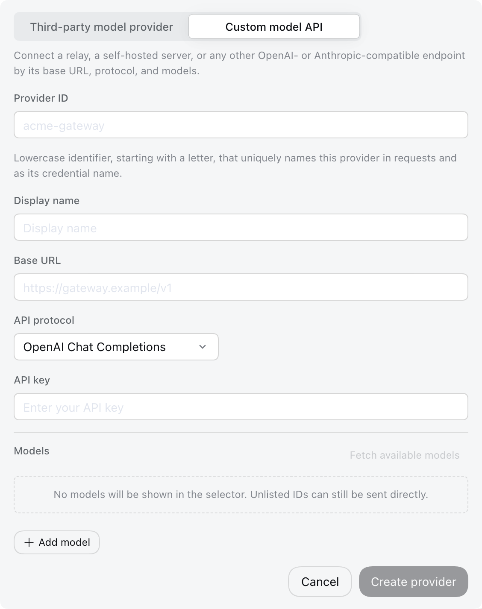

<a id="configure-models"></a>

# Configurar modelos

<!-- USER_LANGUAGES_START -->
[English](providers.md) | [中文](providers.zh.md) | [Русский](providers.ru.md) | [日本語](providers.ja.md) | [Español](providers.es.md) | [Français](providers.fr.md) | [Deutsch](providers.de.md) | Português | [한국어](providers.ko.md)
<!-- USER_LANGUAGES_END -->

Este guia pressupõe que você iniciou a interface web conforme o [guia de desenvolvimento](../../development.md). As alterações no modelo entram em vigor na próxima solicitação, sem reiniciar o servidor.

<a id="configure-deepseek"></a>

## Configurar o DeepSeek

Abra **Configurações → Modelos**. O cartão do DeepSeek mostra um único campo para a chave de API. Digite a chave e salve.


As chaves são somente para gravação. Após salvar, a página recebe uma descrição com o valor oculto. O segredo nunca é enviado à página. A chave é armazenada em `$DSH_HOME/.credentials.yaml` e as configurações guardam somente a referência à credencial.

Com uma chave salva e o endpoint padrão, os modelos do DeepSeek seguem a lista que a API do DeepSeek publica. A lista carrega quando os modelos são necessários pela primeira vez, atualiza em segundo plano a cada dez minutos enquanto eles estão em uso, e cai de volta para os modelos embutidos quando não pode carregar. Edição **Modelos** em **Configurações personalizadas** mantém sua própria lista em vez disso e pára de seguir a publicada; **Restaurar padrão** segue-lo novamente e recarrega-lo. Enquanto a lista publicada está em uso, o cartão mostra os modelos embutidos, de modo que um modelo recém-publicado aparece apenas no seletor de modelos. A referência [API-chave fornecedor](../../../packages/llm/llm-deepseek-api-key/README.md) possui a listagem, backback, e regras de gating.

<a id="add-a-third-party-provider"></a>

## Adicionar um fornecedor de terceiros

Escolha **Adicionar fornecedor de modelo**. O cartão abre no **Fornecedor de modelos de terceiros**: escolha um provedor com o dsh ships — a lista mostra ids de provedores como o `anthropic`, `openai`, `moonshotai` para Kimi, ou o `zai` para GLM — digite sua chave API e salve. O catálogo instalado fornece o endpoint, protocolo e lista de modelos.

A autenticação **?** explica os fallbacks de prioridade e ambiente salvos. Deixe a chave em branco para usar uma credencial salva ou tente as variáveis de ambiente listadas. Uma dica verde identifica uma variável de ambiente detectada. Uma dica amarela significa que nenhuma variável credencial foi detectada; insira uma chave API ou configure a variável listada. Uma dica não confirmada significa que o estado lido falhou. A detecção não valida a credencial nem testa a conexão. Arquivos credenciais gerenciados pelo provedor, incluindo perfis AWS e credenciais padrão de aplicativos do Google, estão fora desta verificação. Os provedores sem autenticação de chave nativa, como `openai-codex`, não mostram nenhum campo de chave a menos que o perfil nomeie explicitamente uma referência credencial.

Uma credencial salva exibe uma visualização mascarada na entrada e uma dica verde de que a chave salva será usada. A pré-visualização retém o identificador antes do primeiro hífen ou sublinhado, depois cinco caracteres principais e quatro caracteres chave seguintes, apenas quando pelo menos oito caracteres do meio permanecem ocultos; caso contrário, a chave e identificador inteiros tornam-se pontos. As contas usam pontos de código Unicode. Chaves salvas não têm botão de olho e não podem ser reveladas, copiadas, cortadas ou parcialmente editadas; digitar ou colar substitui a chave inteira. Backspace ou Excluir etapas de remoção de teclas inteiras. Pressione Backspace ou Delete, em seguida, **Aplicar**, para remover o cancelamento armazenado e usar a autenticação do ambiente. Esvaziando uma substituição também está a eliminação da chave salva. **Cancelar** preserva a chave salva antes de salvar. Uma exclusão recusada deixa as configurações inalteradas. Se a chave for removida, mas as configurações falharem, o aviso informa que a exclusão não pode ser desfeita; tente novamente **Aplicar** para terminar as configurações, ou **Fechar** para deixar o resultado parcial. Limpar uma credencial compartilhada afeta cada recurso usando a mesma referência. Sem uma credencial de ambiente, o provedor não tem autenticação após a limpeza. Retalho do ambiente usa **Deixe em branco para usar env como auth** e uma dica de detecção enquanto a entrada está vazia. Um rascunho de substituição mostra um lembrete para aplicar a nova chave. Na pendência da remoção nomeia-se a variável de ambiente usada após a aplicação, quando a rota declara uma. Outras entradas não vazias não mostram nenhum texto de estado de autenticação. Variáveis de configuração de endereço aparecem sob **URL base** e não contam como credenciais.

Um rascunho de chave editável e não vazio tem um botão de olho. Selecione **Mostrar segredo** para verificar o que você digitou, e **Esconder segredo** para mascara-lo novamente. Mudar a entrada mascara-a novamente. Os campos de senha nativos não oferecem corte; selecione o rascunho e pressione Backspace para apagá-lo ou revelá-lo antes de cortá-lo. As credenciais armazenadas permanecem somente para escrita.

<a id="add-a-custom-model-api"></a>

## Adicionar uma API de modelo personalizada

Mude o cartão para **Modelo personalizado API** para um relé, um gateway da empresa, um servidor self-hosted, ou qualquer provedor ausente do catálogo instalado. Forneça um ID de provedor minúscula, URL base, protocolo de API, credencial e pelo menos um modelo. O protocolo **API** deve ser o que o seu gateway fala, e o catador oferece quatro: OpenAI Chat Complementations, OpenAI Responses, Mensagens Antrópicas e API Gemini, armazenados no `cordis.patch.yml` do perfil ativo como `openai-completions`, `openai-responses`, `anthropic-messages`e `google-generative-ai`. Uma URL base da API Gemini inclui a versão da API, como `https://gateway.example/v1beta`. Um provedor fala um protocolo, então um gateway que serve dois provedores precisa de dois provedores.



O ID do Provedor é permanente porque requisições, sessões salvas, padrões de modelos e referências credenciais o usam. Para renomear um provedor, adicione um novo provedor e apague o antigo. O nome do display, URL base, protocolo, credencial e modelos permanecem editáveis.

<a id="discover-models"></a>

### Descubra modelos

Sob **Model catalog**, escolha **Fetch disponíveis modelos** para perguntar o endpoint que modelos ele serve. A requisição usa o URL base, protocolo e chave atualmente no formulário, ou a chave armazenada de um provedor salvo, e a resposta abre um seletor pesquisável: modelos já na lista começam marcados, então procure, marque os modelos para adicionar, desmarque os que devem ser removidos e escolha **Update list**. Modelos configurados o endpoint não lista fica. Nada é armazenado até que você salve ou crie o provedor.

Discovery lê os formatos de listagem que gateways comuns publicam, mas não todas as respostas de endpoint em uma delas, então trate-a como uma conveniência em vez de uma garantia: quando falha ou não lista nada, adicione os IDs do modelo à mão e eles funcionam da mesma forma. Um provedor embutido é sempre respondido a partir do catálogo instalado, mesmo quando sua URL base aponta para um gateway, então busque através de um provedor personalizado para ver o que o gateway realmente serve.

<a id="select-a-model"></a>

## Selecione um modelo

Os provedores configurados aparecem no selecionador de modelos. Selecionar um modelo também o torna o padrão para novas sessões. Uma sessão que já enviou uma solicitação mantém o modelo gravado em seu próprio registro.

Para alterar a ordem do modelo de um provedor, edite-o em **Configurações → Modelos**, abra **Configurações personalizadas**, e arraste o punho de três linhas de um modelo. Você também pode focar o punho e pressionar a tecla de seta para cima ou para baixo. **Aplicar** mantém a ordem; **Cancelar** descarta-a. O selecionador de modelo segue a ordem salva dentro desse provedor.

Se um nome padrão salvo um provedor que foi excluído, o compositor exibe **Select model** e bloqueia a entrada até que outro modelo seja selecionado.

<a id="advanced-configuration"></a>

## Configuração avançada

O catálogo de configuração de plugins [gerado](../../config-catalog.md) lista todos os campos suportados e padrão para cada plugin; [`dsh-llm-pi-ai`](../../config-catalog.md#oceanocean-llm-pi-ai) é a seção provedora que esta página configura. As referências [`dsh-llm-pi-ai`](../../../packages/llm/llm-pi-ai/README.md) e [`dsh-llm-deepseek`](../../../packages/llm/llm-deepseek/README.md) possuem configurações diretas `cordis.patch.yml` , resolução de catálogos, controles de raciocínio, credenciais e erros de adaptador.

::: dica Configurações adicionais A página Modelos expõe a chave de API, o nome de exibição, URL base, protocolo de API, e o id de cada modelo, nome de exibição, janela de contexto, tokens de saída máxima e tipos de entrada, além dos níveis de raciocínio de um modelo em um provedor de API modelo personalizado. Configure os níveis de raciocínio dos modelos de um provedor embutido, switches de compatibilidade de requisição, cabeçalhos, timeouts e política de repetição em `$DSH_HOME/profiles/<profile>/cordis.patch.yml`, o mesmo documento que a página escreve. Edite-o diretamente, ou, quando o navegador é executado na mesma máquina do servidor, abra-o com **Abra o arquivo de configuração** no cabeçalho Configurações; os adaptadores re-ler no próximo pedido, então nada precisa de um reinício. As subseções abaixo cobrem os campos de que a maioria dos gateways precisa.

Para o lançamento padrão da interface Web com `dsh web`, `<profile>` é `web`, então o caminho é `$DSH_HOME/profiles/web/cordis.patch.yml`. Se você iniciar um perfil personalizado, use o nome selecionado na inicialização. :::

<a id="image-input"></a>

### Entrada da imagem

Em **Configurações → Modelos**, editar o provedor, abrir **Configurações personalizadas**, e expandir **Modelo opções**. **Tipos de entrada** ocupa sua própria linha abaixo dos campos de capacidade. Selecione **Image** para um modelo que aceita imagens e salva. **Text O** começa selecionado para um novo modelo personalizado sem capacidade de imagem herdada. Pelo menos um tipo deve permanecer selecionado; selecione Imagem antes de limpar Texto para um modelo somente de imagem.

As caixas de seleção salvam `input` para modelos pi-ai e `inputModalities` para o adaptador direto DeepSeek. Você também pode editar o modelo em `$DSH_HOME/profiles/<profile>/cordis.patch.yml`; por exemplo, este provedor personalizado de pi-ai declara um modelo somente de texto e um modelo de visão:

Estes exemplos mostram campos de configuração dentro de um patch de perfil. Um sobreposição de configuração do Cordis substitui a configuração completa do item; preserva outros provedores e campos ao editar um sobreposição existente.

```yaml
- id: llm-pi-ai
  config:
    providers:
      my-gateway:
        apiKeyEnv: GATEWAY_API_KEY
        api: openai-completions
        baseURL: https://gateway.example/v1
        models:
          - id: legacy-chat
          - id: vision-preview
            input: [text, image]
```

Pi-ai. `input` aceita `text` e `image` e aplica- se apenas a esse modelo. Uma selecção explícita não vazia tem prioridade. Uma opção omitida ou vazia `input` herda os tipos de entrada do catálogo instalado, em seguida, a rota `defaultInput`, que por omissão `[text]`. As caixas de seleção exibem esses valores herdados sem salvar um sobreposição quando você simplesmente abre a linha.

DeepSeek trata um `inputModalities` omitido apenas como texto e rejeita uma lista vazia. Limpar Imagem também remove que o modelo `imagePixelBudget` e `imageMaxBytes`, porque DeepSeek rejeita limites de imagem em um modelo somente de texto. Defina esses limites novamente se você mais tarde habilitar imagens e precisar de limites personalizados.

Para restaurar a herança depois de editar as caixas de seleção, remova o campo `input` ou `inputModalities` do `cordis.patch.yml`. **Restaurar os padrões** remove todo o cancelamento do catálogo do modelo, incluindo outras edições do modelo, então use-o apenas quando quiser restaurar todo o catálogo.

Se cada modelo que você entrou à mão pega imagens, defina o retrocesso uma vez na rota em vez de em cada um deles:

```yaml
- id: llm-pi-ai
  config:
    providers:
      vision-gateway:
        apiKeyEnv: GATEWAY_API_KEY
        api: openai-completions
        baseURL: https://vision.example/v1
        defaultInput: [text, image]
        models:
          - id: first-model
          - id: second-model
```

`defaultInput` é um retrocesso, não um sobreposição, e defaults para `[text]`: em um provedor built-in ele responde apenas para modelos seu catálogo não descreve, assim ele nunca remove imagens de um modelo de catálogo que tem. Estreite um daqueles com `input`próprio do modelo. Quando um provedor embutido não tem lista `models` explícita, escreva-o em `modelOverrides`, chaveado pelo id do modelo:

```yaml
- id: llm-pi-ai
  config:
    providers:
      anthropic:
        modelOverrides:
          claude-sonnet-4-5:
            input: [text]
```

Na configuração pi-ai, cada lista deve nomear pelo menos uma modalidade, exceto `input`de um modelo, onde uma lista vazia significa o mesmo que omiti-la. Uma modalidade desconhecida é recusada onde quer que seja escrita.

Ambos os campos declaram uma reivindicação sobre o seu endpoint em vez de o verificar. Um modelo que declara as imagens que o seu endpoint não serve não é capturado aqui; o provedor rejeita a solicitação em vez disso.

<a id="deepseek-account-models"></a>

### Modelos de conta DeepSeek

Uma conta de DeepSeek lista seus modelos a partir do serviço de conta, então a página Modelos não oferece nenhum editor de modelo para ele. Ajuste um único modelo com `modelOverrides` em `$DSH_HOME/profiles/<profile>/cordis.patch.yml`; os campos correspondem a uma entrada DeepSeek `models` , e os campos não definidos mantêm os valores listados:

```yaml
- id: llm-deepseek-account
  config:
    modelOverrides:
      deepseek-flash:
        contextWindow: 524288
        maxTokens: 131072
```

Um modelo que precisa de um Oceano mais novo falha com `CLIENT_UPGRADE_REQUIRED`, que nomeia a versão a instalar. O provedor de conta [referência](../../../packages/llm/llm-deepseek-account/README.md) possui as regras de listagem, backback, e gating.

<a id="reasoning-effort"></a>

### Esforço de fundamentação

O seletor de modelos oferece um menu **Esforço** para um modelo que declara níveis de raciocínio. Os modelos de um provedor embutido herdam seus níveis do catálogo instalado, e os modelos da DeepSeek mantêm os níveis do adaptador. Um modelo que você digita manualmente declara nenhum até que você os adicione, então até então a entrada Esforço não aparece no menu e o próprio padrão do endpoint decide se o modelo pensa.

Em um provedor de API modelo personalizado, declarar os níveis em **Configurações → Modelos**: editar o provedor, abrir **Configurações personalizadas**, expandir **Modelo opções**do modelo, e ligar **Níveis de raciocínio**. As linhas começam com off, baixo, médio e alto. Cada linha combina um nível com o valor **API** enviado para ele, que é padrão para o nome do nível; altere-o apenas onde a documentação API do fornecedor do modelo soletra o nível de forma diferente. Adicionar ou excluir linhas para corresponder ao que o endpoint suporta, manter pelo menos um nível além de desligado, e salvar. Desligar o interruptor remove a declaração.

A página escreve `reasoningEfforts` em `$DSH_HOME/profiles/<profile>/cordis.patch.yml`, onde você também pode declarar os níveis diretamente:

```yaml
- id: llm-pi-ai
  config:
    providers:
      my-gateway:
        apiKeyEnv: GATEWAY_API_KEY
        api: openai-completions
        baseURL: https://gateway.example/v1
        reasoning: high
        models:
          - id: my-reasoner
            reasoningEfforts:
              off:
              high: high
              max: max
```

Cada chave é um nível que o menu oferece, e seu valor é a ortografia enviada no fio como `reasoning_effort`, assim `max: xhigh` renomeia um nível para um gateway com seu próprio vocabulário. Apenas `off` pode permanecer vazio, porque para a maioria dos endpoints não pensar é a ausência do parâmetro. O `reasoning` da rota é o nível usado enquanto uma sessão não escolheu nenhum; escolher um esforço no coletor salva-o, com o modelo, como padrão para novas sessões.

Um `off` deixado em branco não envia nada, o que só para um modelo que pensa sob solicitação; um `off` dado um valor envia esse valor como `reasoning_effort` em vez disso. Um modelo que pensa que a menos que dito para não — DeepSeek V4 atrás de um gateway compatível com OpenAI, por exemplo — precisa de `compat.thinkingFormat: deepseek`, o que faz `off` enviar `thinking: {type: disabled}` e todos os outros níveis enviar `thinking: {type: enabled}` ao lado do esforço:

```yaml
        models:
          - id: deepseek-v4-pro
            compat:
              thinkingFormat: deepseek
            reasoningEfforts:
              off:
              high: high
              max: max
```

O modelo de um provedor integrado cujo gateway não raciocina perde seus níveis com `reasoningEfforts: false` sob `modelOverrides`; selecionando um esforço para ele é então recusado como `UNSUPPORTED_REASONING_EFFORT`. A própria rota de DeepSeek não precisa de nada disso: seus modelos já oferecem `off`, `low`, `high`, e `max`, e `llm-deepseek.reasoningEffort` define o padrão do catador começa a partir de:

```yaml
- id: llm-deepseek
  config:
    reasoningEffort: max
```

<a id="request-compatibility"></a>

### Pedido de compatibilidade

Um gateway pode segurar uma chave de trabalho em um endereço acessível e ainda recusar cada solicitação. pi-ai decide a forma de uma solicitação — qual papel carrega o prompt do sistema, qual campo tampa a saída, como um nível de pensamento viaja — a partir da URL do endpoint, e um endereço que ele não reconhece é abordado como se fosse o próprio OpenAI. A maioria dos gateways compatíveis com OpenAI recusam pelo menos uma coisa que o OpenAI aceita.

Dois são a maior parte. Um modelo que declara raciocínio tem seu prompt de sistema enviado como `role: "developer"`, que muitos gateways rejeitam outright, e a tampa de saída é enviada como `max_completion_tokens`, que um servidor que só conhece `max_tokens` recusa. O formulário não tem campo para nenhum dos dois; corrija-os na rota em `$DSH_HOME/profiles/<profile>/cordis.patch.yml`:

```yaml
- id: llm-pi-ai
  config:
    providers:
      my-gateway:
        apiKeyEnv: GATEWAY_API_KEY
        api: openai-completions
        baseURL: https://gateway.example/v1
        compat:
          supportsDeveloperRole: false
          maxTokensField: max_tokens
        models:
          - id: my-model
```

Uma rota `compat` é o padrão para os seus modelos, e o próprio modelo ganha campo por campo, para que um modelo possa ser corrigido sem reiniciar a rota:

```yaml
        models:
          - id: my-model
          - id: my-reasoner
            compat:
              thinkingFormat: deepseek
```

O que nenhum dos conjuntos mantém o valor do catálogo instalado para esse modelo, e o que o catálogo não descreve cai na detecção do pi-ai. Dê a cada interruptor um valor: uma chave deixada em branco (`supportsDeveloperRole:`) é recusada em vez de ignorada, porque um valor vazio apagaria o que o catálogo sabe enquanto não diz nada em seu lugar. Um nome que nenhum protocolo aceita também é recusado, e a mensagem lista os que estão disponíveis.

Cada switch pertence aos protocolos que declaram isso, então um switch válido em um `api` pode ser recusado em outro — os nomes de mensagem que esse protocolo oferece. Como o `input` acima, um switch declara uma reivindicação sobre seu endpoint em vez de verificá-lo: definir um seu gateway não precisa, na verdade, simplesmente enviar uma solicitação diferente.

Cada switch, seus valores aceitos, e os protocolos que o tomam estão listados sob `PiAiCompatProfile` no [gerado `dsh-llm-pi-ai` referência de configuração](../../config-catalog.md#oceanocean-llm-pi-ai) - que é derivado da fonte, então ele não pode ficar para trás o que o adaptador aceita.

<a id="troubleshooting"></a>

## Resolução de Problemas

- **`MISSING_CREDENTIAL`** — Armazenar a chave do fornecedor através da página Modelos ou fornecer a variável de ambiente referenciada.
- **`UNKNOWN_MODEL`** — Selecione um modelo configurado ou adicione o modelo em falta ao provedor personalizado.
- **Obter modelos disponíveis retorna 401** — Verifique a chave. A descoberta do modelo chama o endpoint compatível com o OpenAI `GET /models` ; insira modelos manualmente para os endpoints que não o fornecem.
- **Obtendo relatórios de modelos disponíveis `data` array nem a `models` objeto** — A listagem do endpoint está num formato que não é lido.
- **O gateway recusa todos os pedidos, embora a chave e URL estejam certas** — Sua forma de solicitação difere da OpenAI. Comece com `compat.supportsDeveloperRole: false` e `compat.maxTokensField: max_tokens` na rota.
- **Apenas os modelos de raciocínio falham** — pi-ai envia seu prompt de sistema como o papel `developer` , que o gateway rejeita. `compat.supportsDeveloperRole: false`.
- **O menu Esforço não aparece para um modelo que você inseriu à mão** — Declara que não há níveis. Em um provedor de API modelo personalizado, ligue **Raciocínio níveis** nas opções **Modelo**do modelo; em outro lugar, adicione `reasoningEfforts` ao modelo em `cordis.patch.yml`.
- **`off` não impede um modelo DeepSeek de pensar** — Um `off` vazio não envia nenhum campo de raciocínio, e um endpoint que pensa por padrão continua pensando. Defina `compat.thinkingFormat: deepseek` no modelo ou na rota.
- **Um compat switch é recusado como não tendo valor** — Uma chave escrita sem nada após o cólon. Dê-lhe um valor, ou remova a chave para manter o catálogo instalado.
- **Uma imagem é recusada antes de enviar o** — O modelo declara não haver modalidade de imagem. Dê o modelo de um provedor personalizado `input: [text, image]`; na rota própria de DeepSeek, selecione uma entrada com capacidade de imagem do catálogo configurado (`deepseek-flash` por padrão) e confirme que seu gateway serve esse modelo com entrada de imagem.
- **O provedor rejeita uma solicitação carregando uma imagem** — O modelo declara imagens que seu endpoint não serve. Remova `image` de qualquer lista concedida – `input`do modelo, ou `defaultInput` da rota – em seguida, inicie uma nova sessão: a imagem anexa permanece no registro de sessão, então a mesma solicitação se repete até que a sessão se mova.
