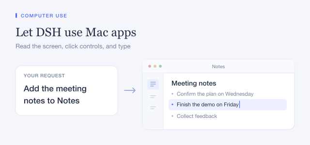

## Linux: check readiness before granting access

Enabling this plugin loads the provider; it does not grant access to applications. Open its permission panel and check AT-SPI accessibility and desktop-session status before approving an application. Linux supports accessible controls and semantic actions only, not screen capture, global mouse/keyboard input, or application launch. Applications without AT-SPI support remain unsupported.

Run Ocean in your signed-in, unlocked graphical session. If the session status is unknown, do not disable the guard or copy a session ID from another machine. A user-service launch may require an explicit `sessionId` in the Linux provider configuration after identifying your intended local graphical session. The Linux provider accepts an optional `sessionId` configuration value; this page does not automatically select or save it. The helper validates the current user, active local session, seat and lock state; uncertain or locked state blocks observation and input. Changing the configured session does not grant application permission.

Application consent is separate from readiness. Session-only access is shown in the permission panel and can be revoked there. The underlying AT-SPI bus is user-wide; Ocean's per-application checks are not OS-enforced sandbox isolation.

## Windows helper

Windows npm installations require a separate helper. On x64, extract the entire standalone ZIP and set the provider’s `helperPath` to the absolute path of `dsh-cua-windows.exe`. On ARM64, use a helper built for that architecture.

