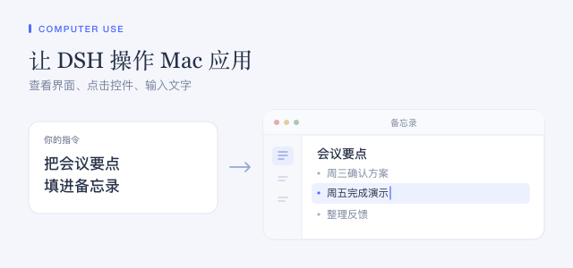

## Linux：授权前检查就绪状态

启用插件只加载提供程序，不会授予应用访问权限。请先在权限面板检查 AT-SPI 和桌面会话状态，再批准应用。Linux 仅支持辅助功能控件和语义操作，不支持截图、全局鼠标或键盘输入，也不启动应用。不提供 AT-SPI 的应用不受支持。

请在已登录且解锁的图形会话中运行 Ocean。如果会话状态未知，不要关闭保护，也不要复制其他计算机的会话 ID。用户服务启动方式可能需要在确认目标本地图形会话后，为 Linux 提供程序显式配置 `sessionId`。Linux 提供程序接受可选的 `sessionId` 配置项；此页面不会自动选择或保存该值。辅助进程会验证当前用户、活动本地会话、seat 和锁定状态；未知或锁定状态会阻止读取及输入。更改会话配置不会授权应用。

就绪状态与应用授权是独立的。会话级授权会显示在权限面板中，并可在此撤销。AT-SPI 总线本身属于整个用户会话；Ocean 的应用级检查不是操作系统沙箱隔离。

## Windows 辅助程序

在 Windows 上通过 npm 安装 DSH 后，需要单独配置 helper。x64 用户可完整解压独立 ZIP，再将提供方的 `helperPath` 设为 `dsh-cua-windows.exe` 的绝对路径。ARM64 用户需要对应架构的 helper。

