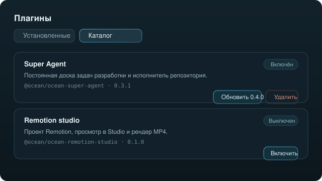

# Каталог плагинов

Откройте **Плагины → Каталог**, чтобы посмотреть подборку и управлять плагинами текущего профиля. Поиск учитывает название, описание и имя пакета. Кнопка **Подробнее** открывает полное описание и показывает актуальное состояние плагина.

## Установка

- Если Ocean предлагает точную версию официального пакета, нажмите **Установить**.
- Если источник не указан, нажмите **Установить из источника**. В форме **Добавить плагин** будет подставлено имя пакета. Замените его, если нужно, на адрес Git, архив или путь к локальному каталогу. Открытие формы само по себе ничего не скачивает и не устанавливает.
- Наличие карточки не означает, что пакет опубликован. Каталог не ищет пакеты по публичным реестрам.

## Управление

На карточке доступны те же операции профиля, что на вкладке **Установленные**. Отключение не удаляет пакет. Удаление требует подтверждения и недоступно для пакетов, которые поставляются вместе с Ocean. Если профиль всё ещё ссылается на плагин, чьи файлы пропали, карточка показывает причину и доступные действия.

Для пакета из реестра каталог предлагает только точную версию из подборки, если она новее установленной. Обновление из Git доступно на странице пакета на вкладке **Установленные**.
